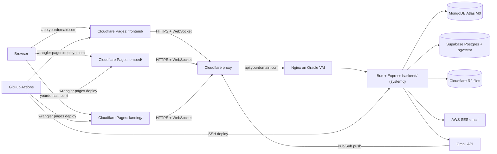

# Inboundr — Free-Tier Cloud Deployment Plan

This folder is the step-by-step plan for running all of Inboundr (backend API, dashboard, embed, landing) in the cloud using only free tiers. The backend runs on an **Oracle Cloud Always Free** VM.

Follow the steps **in order**. Each file says what to use, how to use it, which part of the repo it deploys, and what the step handles in the bigger picture.

## Target architecture

## Sequence

| # | Step | Repo part deployed / configured | Free tool |
|---|------|-------------------------------|-----------|
| 01 | [Domain, Cloudflare and Turnstile](01-domain-and-cloudflare.md) | DNS for every app, Turnstile keys for `embed/` and `backend/` | Cloudflare Free |
| 02 | [MongoDB](02-mongodb-atlas.md) | `backend/` main database (auth, orgs, CRM, invoices, ...) | MongoDB Atlas M0 |
| 03 | [Postgres + pgvector](03-postgres-supabase.md) | `backend/` product catalog and RAG embeddings | Supabase Free |
| 04 | [File storage](04-file-storage-r2.md) | `backend/` Drive, uploads, forms, attendance files | Cloudflare R2 |
| 05 | [Google Cloud: OAuth, Gmail, Pub/Sub](05-google-cloud-oauth-gmail-pubsub.md) | `backend/` sign-in, Gmail sync, RFQ ingestion | Google Cloud free quota |
| 06 | [Transactional email](06-email-aws-ses.md) | `backend/` digests, notifications | AWS SES |
| 07 | [Oracle VM](07-oracle-vm-provisioning.md) | The server that will host `backend/` | Oracle Cloud Always Free |
| 08 | [Backend on the VM](08-backend-on-oracle-vm.md) | `backend/` (Bun, systemd, Nginx, TLS) | Bun, Nginx, Cloudflare Origin CA |
| 09 | [Backend CI/CD](09-backend-ci-cd.md) | `.github/workflows/backend-deploy.yml`, `scripts/deploy/` | GitHub Actions |
| 10 | [Frontends](10-frontends-cloudflare-pages.md) | `frontend/`, `embed/`, `landing/` | Cloudflare Pages |
| 11 | [Wire-up and go-live](11-wire-up-and-go-live.md) | Cross-service URLs, webhooks, smoke test, cutover | — |
| 12 | [Monitoring, backups, operations](12-monitoring-backups-operations.md) | Day-2 operations for everything above | UptimeRobot, cron, rclone |

Steps 02–06 do not depend on each other and can be done in parallel. 07 → 08 → 09 must be done in order. 10 needs the API domain from 01. 11 needs everything.

## Conventions used in these plans

- `yourdomain.com` stands for your real domain. Subdomains:
  - `api.yourdomain.com` → backend (Oracle VM)
  - `app.yourdomain.com` → dashboard (`frontend/`)
  - `forms.yourdomain.com` → embed (`embed/`)
  - `yourdomain.com` (+ `www` redirect) → landing (`landing/`)
- All frontends **must** be on subdomains of the same domain as the API. Better Auth cookies are set by `api.yourdomain.com`, and browsers won't send them from a different site such as `*.pages.dev`.
- Secrets go only in `backend/.env` on the VM, in GitHub Actions secrets, or in Cloudflare. Never commit them.
- Only **one** backend instance may run at a time. Gmail watches, Pub/Sub processing and the in-process `Bun.cron` jobs are not safe to run on more than one instance.

## Cost summary

| Item | Cost |
|------|------|
| Oracle VM (Always Free A1 ARM) | $0 |
| Cloudflare DNS, proxy, Pages, Turnstile, R2 (10 GB) | $0 |
| MongoDB Atlas M0 (512 MB) | $0 |
| Supabase Free (500 MB) | $0 |
| Google Cloud Pub/Sub (10 GB/month free) | $0 |
| AWS SES (free allowance for 12 months, then about $0.10 per 1,000 emails) | ~$0 |
| GitHub Actions, UptimeRobot | $0 |
| Domain name | ~$10/year |
| OpenRouter / OpenAI usage (chat, RFQ agents, embeddings, voice) | Pay per use, no free option |

Check each provider's current free-tier terms before you sign up. They change.
